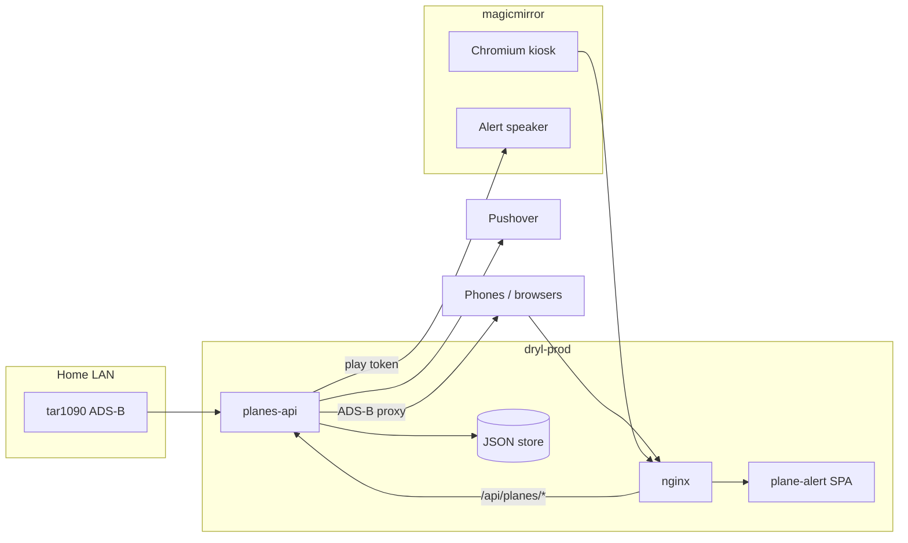

# Plane Alert

Personal ADS-B radar for the home antenna: live map, radius search, military and special-aircraft highlighting, weather and sky chrome, Pushover alerts, and a wall-mounted kitchen kiosk.

| URL | What |
|-----|------|
| [planes.dryl.io](https://planes.dryl.io) | Main map (PWA) |
| [planes.dryl.io/sightings](https://planes.dryl.io/sightings) | Lifetime unique aircraft from the home feed |
| [planes.dryl.io/?setup=pushover](https://planes.dryl.io/?setup=pushover) | Register a device for Pushover alerts |

Stack: **Angular 19** SPA, **Leaflet** map, **@dryl/ui** + fleet auth packages, **planes-api** (Node/Express on dryl-prod). There is **no Firestore, FCM, or Firebase Cloud Functions** in this project anymore.

## Architecture



- **SPA** (`src/`): map UI, settings, device registration, sightings table route.
- **planes-api** (`functions/`): device registry, ADS-B point proxy, military history, antenna sightings poller, reverse geocode, notification cron. Persists to a **local JSON file** on the Pi (see `PLANES_API_STORE_PATH`).
- **Kiosk**: Chromium on magicmirror only; API and static hosting stay on dryl-prod. Alert MP3s hit a small listener on the kiosk host (see `.cursor/rules/debugging.md`).

Physical host names and IPs live in fleet docs (`directory/docs/INFRASTRUCTURE.md`) — not duplicated here.

## Map features

- **Location**: search address, use GPS, set/go to home; adjustable search radius (km).
- **Aircraft**: live positions from multiple ADS-B sources via `adsbPointProxy` (avoids browser CORS); operator logos, country flags, type icons (including balloon/helicopter edge cases).
- **Overlays**: view cones, window-view / altitude bands, rain, clouds, sun/moon/wind readouts, 24-hour clock and temperature for the map center timezone.
- **Lists**: planes in range, peeped/history strip, follow aircraft on map.
- **Military / special**: shared detection rules (`@plane-alert/shared`); history API backed by planes-api.
- **Sightings**: separate `/sightings` page (toolbar cell-tower icon on the main map). Kiosk stays on `/`.

Settings and overlay toggles live in the left toolbar and results panel. Kiosk mode trims chrome via `kiosk` query / install profile (see `scripts/pi-install-planes-kiosk.py`).

## planes-api

Built from `functions/` (`npm run build --prefix functions`). Installed on dryl-prod with:

```bash
python scripts/pi-install-planes-api.py
```

Nginx exposes the app under **`/api/planes/`** (see `src/app/config/planes-api.config.ts`).

| Route | Purpose |
|-------|---------|
| `GET /adsbPointProxy` | Server-side ADS-B fetch for lat/lon/radius |
| `POST /registerDevice`, `/checkDevice` | Pushover user key + home/radius |
| `GET /getMilitaryHistory`, `POST /saveMilitarySighting` | Military sighting log |
| `GET /antennaSightings` | Aggregated home-antenna unique hex list |
| `GET /reverseGeocode` | Address lookup for the SPA (do not call Nominatim from the browser) |
| `GET /health` | Build info, device count, notification health, antenna poller status |

Cron (local time on the API host): collect aircraft every **5** minutes; run notification processing every **2** minutes; health watchdog every **15** minutes.

**Do not** copy `/home/pi/planes-api/.env` from a laptop when deploying — it holds production Pushover and kiosk play tokens.

## Push notifications (Pushover only)

Automatic alerts are **server-side**. The SPA does not register FCM tokens or ship a notification service worker (`lint:no-fcm-sw` enforces this).

1. Sign up at [pushover.net](https://pushover.net).
2. Open [setup link](https://planes.dryl.io/?setup=pushover) on each device and enter your user key.
3. Set home and radius in the app.

`PLANES_API_PUSHOVER_ENABLED` gates sends per environment (prod vs staging). Dedup, quiet hours, and kiosk audio are documented in `.cursor/rules/debugging.md`.

## Antenna sightings

Every unique ICAO hex reported by the home feed is upserted by planes-api.

- **UI**: [planes.dryl.io/sightings](https://planes.dryl.io/sightings)
- **Feed**: `http://192.168.178.27/tar1090/data/aircraft.json` (tar1090: `http://192.168.178.27/tar1090/`)
- **Poller**: ~12s on dryl-prod
- **File**: `/home/pi/planes-api/data/antenna-sightings.json`

Optional `.env` keys (defaults match home tar1090 if omitted):

```
PLANES_ANTENNA_FEED_URL=http://192.168.178.27/tar1090/data/aircraft.json
PLANES_ANTENNA_POLL_MS=12000
PLANES_ANTENNA_SIGHTINGS_PATH=/home/pi/planes-api/data/antenna-sightings.json
PLANES_ANTENNA_ENABLED=1
```

Set `PLANES_ANTENNA_ENABLED=0` to pause.

## Shared package

`shared/` → `@plane-alert/shared`: military/country detection and geo helpers used by **both** the SPA and planes-api. Build: `npm run build:shared` (runs in `prebuild`). Details: `shared/README.md`.

## Local development

Prerequisites: Node 20+, sibling repos `dryl/` (for `@dryl/ui` and auth packages) and `directory/` (for lint/deploy scripts).

```bash
npm install
npm start
```

- `npm start` → `server.js` (local aircraft DB helper on :3001) + `ng serve` with `proxy.conf.json` (`/api/planes` → dryl-prod LAN IP by default).
- `npm run build` → `dist/plane-alert/browser` (runs UI lint + shared build first).

## Deploy and verify

Hosted site id: **`planes`** in `directory/scripts/dryl-static-sites.json`.

```bash
npm run deploy:staging
npm run verify:staging
# merge to main, then:
npm run deploy:dryl
npm run verify:console
npm run verify:visual
```

Backend-only or kiosk:

```bash
npm run deploy:backend          # planes-api on prod Pi
python scripts/pi-install-planes-kiosk.py   # magicmirror kiosk + watchdog
```

Ops symptoms and failed experiments: `.cursor/rules/debugging.md`. Fleet agent entry: `AGENTS.md` (pointer to `speculation/AGENTS.md`).

## Geocoding

Production address lookup goes through **planes-api** `reverseGeocode`. If client geocoding misbehaves during local dev, you can disable it in the browser:

```javascript
localStorage.setItem("disable-geocoding", "true");
location.reload();
```

```javascript
localStorage.removeItem("disable-geocoding");
location.reload();
```

## Tests and lint

```bash
npm run lint:ui
npm test
npm run test:local-tx    # planes-api + Pushover/kiosk/antenna self-tests
npm run verify:backend   # fleet probe against live API
```
