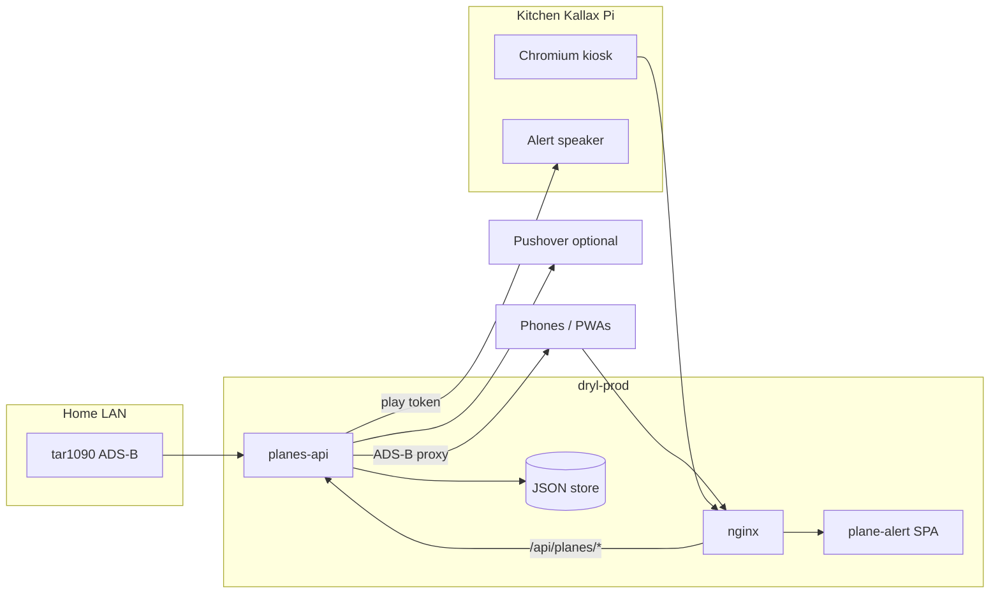

# Plane Alert

Personal ADS-B radar for the home antenna: live map, radius search, military and special-aircraft highlighting, weather and sky chrome, optional phone alerts, and a fullscreen map on a **Pi in the kitchen Kallax** (not wall-mounted).

| URL | What |
|-----|------|
| [planes.dryl.io](https://planes.dryl.io) | Main map (installable PWA) |
| [planes.dryl.io/sightings](https://planes.dryl.io/sightings) | Lifetime unique aircraft from the home feed |
| [planes.dryl.io/?setup=pushover](https://planes.dryl.io/?setup=pushover) | Legacy Pushover device registration (optional) |

Stack: **Angular 19** SPA, **Leaflet** map, **@dryl/ui** + fleet auth packages, **planes-api** (Node/Express on dryl-prod). There is **no Firestore, FCM, or Firebase Cloud Functions** in this project anymore.

## Architecture



- **SPA** (`src/`): map UI, settings, device registration, sightings table route.
- **planes-api** (`functions/`): device registry, ADS-B point proxy, military history, antenna sightings poller, reverse geocode, notification cron. Persists to a **local JSON file** on the Pi (see `PLANES_API_STORE_PATH`).
- **Kitchen display**: Chromium kiosk on the Pi in the Kallax (fleet hostname `magicmirror`); API and static hosting stay on dryl-prod. Alert chimes use a small listener on that Pi (see `.cursor/rules/debugging.md`).

Physical host names and IPs live in fleet docs (`directory/docs/INFRASTRUCTURE.md`) — not duplicated here.

## Map features

- **Location**: search address, use GPS, set/go to home; adjustable search radius (km).
- **Aircraft**: live positions from multiple ADS-B sources via `adsbPointProxy` (avoids browser CORS); operator logos, country flags, type icons (including balloon/helicopter edge cases).
- **Overlays**: view cones, window-view / altitude bands, rain, clouds, sun/moon/wind readouts, 24-hour clock and temperature for the map center timezone.
- **Lists**: planes in range, peeped/history strip, follow aircraft on map.
- **Military / special**: shared detection rules (`@plane-alert/shared`); history API backed by planes-api.
- **Sightings**: separate `/sightings` page (toolbar cell-tower icon on the main map). Kiosk stays on `/`.

Settings and overlay toggles live in the left toolbar and results panel. Kiosk mode trims chrome via `kiosk` query / install profile (see `scripts/pi-install-planes-kiosk.py`).

## planes-api

Built from `functions/` (`npm run build --prefix functions`). Installed on dryl-prod with:

```bash
python scripts/pi-install-planes-api.py
```

Nginx exposes the app under **`/api/planes/`** (see `src/app/config/planes-api.config.ts`).

| Route | Purpose |
|-------|---------|
| `GET /adsbPointProxy` | Server-side ADS-B fetch for lat/lon/radius |
| `POST /registerDevice`, `/checkDevice` | Device registration (Pushover user key today) + home/radius |
| `GET /getMilitaryHistory`, `POST /saveMilitarySighting` | Military sighting log |
| `GET /antennaSightings` | Aggregated home-antenna unique hex list |
| `GET /reverseGeocode` | Address lookup for the SPA (do not call Nominatim from the browser) |
| `GET /health` | Build info, device count, notification health, antenna poller status |

Cron (local time on the API host): collect aircraft every **5** minutes; run notification processing every **2** minutes; health watchdog every **15** minutes.

**Do not** copy `/home/pi/planes-api/.env` from a laptop when deploying — it holds production secrets (Pushover keys, kiosk play tokens).

## Alerts and notifications

**Kitchen Kallax:** the map runs fullscreen on the Pi; military/special flyovers can play a chime on the speaker wired to that box.

**Phones and laptops (PWA):** Plane Alert is an installable PWA. The app already uses the browser **Web Notifications** API (permission prompt, `Notification` in `notification.service`) so alerts can surface from the installed app without a third-party inbox. That is the preferred long-term direction instead of Pushover.

**What runs in production today:** planes-api still has an optional **Pushover** path for background polling while the PWA is closed (`registerDevice` / cron on the API). You do not have to use it — set `PLANES_API_PUSHOVER_ENABLED=0` on the server to mute sends. Legacy setup: [pushover.net](https://pushover.net) + [?setup=pushover](https://planes.dryl.io/?setup=pushover).

There is **no Firestore or FCM service worker** in this repo (`lint:no-fcm-sw`). A future native web-push stack would be a new service worker + push subscription endpoint, not the old Firebase setup.

Dedup, quiet hours, and kiosk audio: `.cursor/rules/debugging.md`.

### Push notification copy (example)

Pushover messages use a **title** and **body**. The installed PWA uses the same body formatter when it shows a Web Notification for a military aircraft in range.

**Examples (Pushover or PWA — same formatters):**

| Case | Title | Body |
|------|-------|------|
| Model + operator | `Airbus A400M · Luftwaffe` | `Rudow SE · E-bound · 7,600 m ↑` |
| Model only | `Airbus A400M` | `Rudow SE · E-bound · 7,600 m` |
| Callsign only | `GAF871` | `Rudow SE · E-bound · 7,600 m` |

Map link (unchanged): `https://planes.dryl.io/?icao=3F717C&follow=1` (“View on Map”).

Title priority: **model** (with **operator** appended only when both exist), else **callsign**, else **operator**, else **ICAO**, else `Aircraft nearby`. The body always leads with place + bearing from home when known, then `[cardinal]-bound`, then altitude (`↑` / `↓` only for meaningful climb or descent). No speed, flags, or filler words.

### How the body is built

One shared function formats the text for **planes-api Pushover** and the **browser** (`@plane-alert/shared` → `formatNotificationBody` in `shared/src/notification-formatter.ts`).

**Server path (background Pushover):**

1. Cron on planes-api runs `runNotificationProcessing` (every ~2 minutes) after ADS-B collection.
2. For each registered home location, aircraft inside the user’s radius that pass the military/special gate are candidates.
3. `buildMilitaryPendingNotification` (`functions/src/services/build-military-notification.ts`) computes bearing from home → plane, cardinal direction, operator from callsign prefixes, and title via `formatNotificationTitle`.
4. `buildNotificationBody` (`functions/src/services/notification-builder.ts`) adds altitude from ADS-B (`alt_baro`, `baro_rate`), track as heading, and optional place name from `reverseGeocode` (never raw lat/lon in the body).
5. `formatNotificationBody` joins up to three segments with ` · `: `[place] [bearing from home]`, `[cardinal]-bound`, `[altitude] [↑|↓]`. Missing fields are omitted with no extra separators.

**Browser path (PWA):** `notification.service` → `buildMilitaryNotificationBody` in `src/app/services/notification/notification.util.ts` calls the same `formatNotificationBody` with units from your distance setting (km vs miles).

To change wording for both phone and map test toasts, edit `shared/src/notification-formatter.ts`, run `npm run build:shared`, then redeploy the SPA and planes-api.

## Antenna sightings

Every unique ICAO hex reported by the home feed is upserted by planes-api.

- **UI**: [planes.dryl.io/sightings](https://planes.dryl.io/sightings)
- **Feed**: `http://192.168.178.27/tar1090/data/aircraft.json` (tar1090: `http://192.168.178.27/tar1090/`)
- **Poller**: ~12s on dryl-prod
- **File**: `/home/pi/planes-api/data/antenna-sightings.json`

Optional `.env` keys (defaults match home tar1090 if omitted):

```
PLANES_ANTENNA_FEED_URL=http://192.168.178.27/tar1090/data/aircraft.json
PLANES_ANTENNA_POLL_MS=12000
PLANES_ANTENNA_SIGHTINGS_PATH=/home/pi/planes-api/data/antenna-sightings.json
PLANES_ANTENNA_ENABLED=1
```

Set `PLANES_ANTENNA_ENABLED=0` to pause.

## Shared package

`shared/` → `@plane-alert/shared`: military/country detection and geo helpers used by **both** the SPA and planes-api. Build: `npm run build:shared` (runs in `prebuild`). Details: `shared/README.md`.

## More docs

| File | Topic |
|------|--------|
| `functions/README.md` | planes-api layout, deploy, legacy Firebase scripts |
| `SECURITY.md` | Secrets on the Pi `.env`, frontend vs backend keys |
| `.cursor/rules/debugging.md` | Kiosk, Pushover dedup, deploy pitfalls |

## Local development

Prerequisites: Node 20+, sibling repos `dryl/` (for `@dryl/ui` and auth packages) and `directory/` (for lint/deploy scripts).

```bash
npm install
npm start
```

- `npm start` → `server.js` (local aircraft DB helper on :3001) + `ng serve` with `proxy.conf.json` (`/api/planes` → dryl-prod LAN IP by default).
- `npm run build` → `dist/plane-alert/browser` (runs UI lint + shared build first).

## Deploy and verify

Hosted site id: **`planes`** in `directory/scripts/dryl-static-sites.json`.

```bash
npm run deploy:staging
npm run verify:staging
# merge to main, then:
npm run deploy:dryl
npm run verify:console
npm run verify:visual
```

Backend-only or kiosk:

```bash
npm run deploy:backend          # planes-api on prod Pi
python scripts/pi-install-planes-kiosk.py   # kitchen Kallax kiosk + watchdog
```

Ops symptoms and failed experiments: `.cursor/rules/debugging.md`. Fleet agent entry: `AGENTS.md` (pointer to `speculation/AGENTS.md`).

## Geocoding

Production address lookup goes through **planes-api** `reverseGeocode`. If client geocoding misbehaves during local dev, you can disable it in the browser:

```javascript
localStorage.setItem("disable-geocoding", "true");
location.reload();
```

```javascript
localStorage.removeItem("disable-geocoding");
location.reload();
```

## Tests and lint

```bash
npm run lint:ui
npm test
npm run test:local-tx    # planes-api + Pushover/kiosk/antenna self-tests
npm run verify:backend   # fleet probe against live API
```
